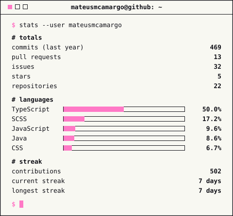

# stats-card

Minimalist GitHub stats card rendered as a static SVG (dark and light variants).

A scheduled workflow runs `generate.py` daily and commits `assets/stats-*.svg` when they change.

## Usage

```sh
STATS_TOKEN=<token> python generate.py
```

Optional secret `STATS_TOKEN` (classic PAT with `read:user`) includes private contributions.
Without it, the workflow falls back to `GITHUB_TOKEN` and counts public data only.

## Embed

```html
<picture>
    <source media="(prefers-color-scheme: dark)" srcset="https://raw.githubusercontent.com/mateusmcamargo/stats-card/main/assets/stats-dark.svg">
    
</picture>
```